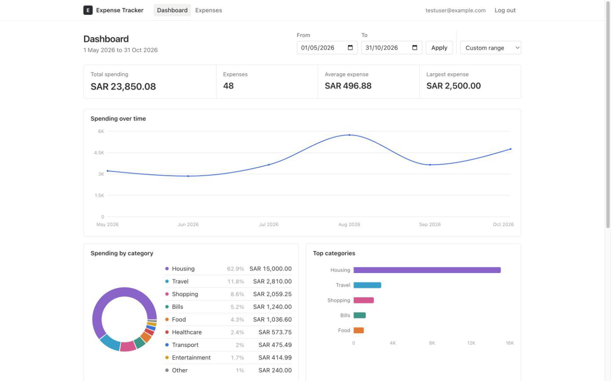
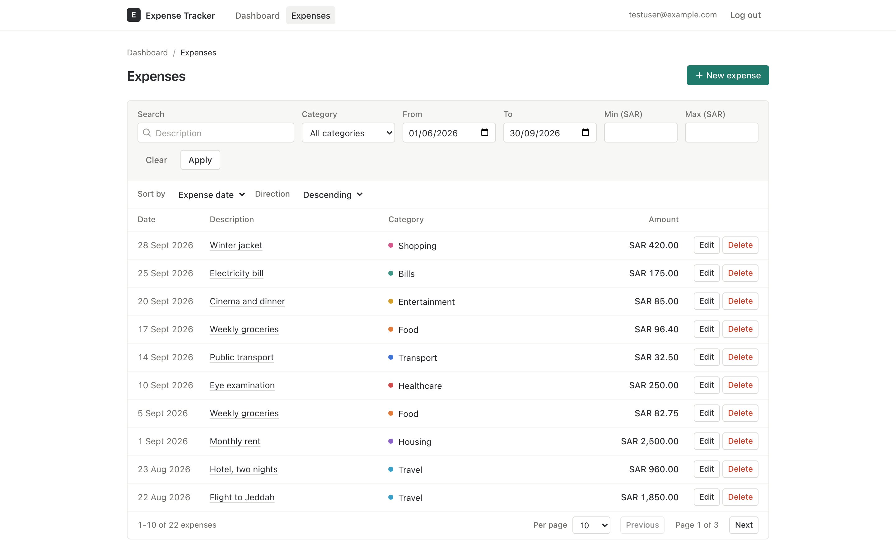
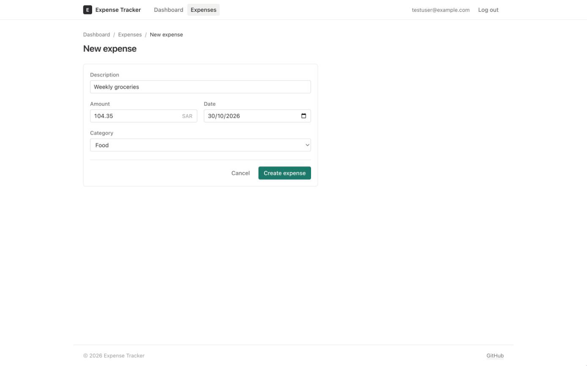
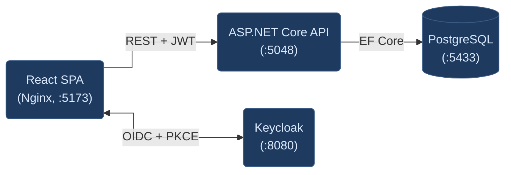

# Personal Expense Tracker

[](https://github.com/HamadSMA/personal-expense-tracker/actions/workflows/ci.yml)

A full-stack app for recording expenses, built with ASP.NET Core, React, TypeScript and PostgreSQL, with sign-in through Keycloak. Each user only gets their own expenses.

## Screenshots


*The dashboard.*

| Expense list | Expense form |
| --- | --- |
|  |  |
| Filtering, sorting and pagination | Creating an expense |

## Features

- **Expenses:** create, read, update and delete expenses with a category, amount, description and date.
- **Search and filters:** search, filter by category, date range and amount, sort and paginate.
- **Dashboard:** total spending, expense count, average and largest expense, spending over time, spending by category and the ten largest expenses, for an optional date range.
- **Accounts:** sign-in through Keycloak.

## Tech Stack

| Area | Technologies |
| --- | --- |
| Backend | C#, ASP.NET Core, EF Core |
| Frontend | React, TypeScript, Vite, React Router, TanStack Query, Recharts |
| Database | PostgreSQL |
| Auth | Keycloak, OpenID Connect (Authorization Code Flow with PKCE), JWT |
| Testing | xUnit, Testcontainers, Vitest, React Testing Library |
| Tooling | Docker, Docker Compose, Nginx, GitHub Actions |

## Architecture



Keycloak handles sign-in. The frontend sends an access token with its API requests, and the API validates the JWT before allowing access to protected endpoints.

The backend uses a Clean Architecture-style structure: four projects whose dependencies point inward, with `Finance.Domain` depending on nothing.

| Project | Responsibility |
| --- | --- |
| `Finance.Domain` | Entities: `User`, `Expense`, `Category` |
| `Finance.Application` | Services, DTOs, validation rules, `IFinanceDbContext` |
| `Finance.Infrastructure` | EF Core, PostgreSQL, migrations |
| `Finance.Api` | Endpoints, auth, configuration |

## Engineering Highlights

**Authentication and data isolation.** The first time a Keycloak user calls the API, the backend creates a matching local user. Expense queries are filtered by that user's id. Requesting another user's expense returns `404` instead of `403`, so its existence isn't revealed.

**Server-side querying.** Filtering, sorting and pagination are applied before the database query runs, which lets it use the index on `UserId` and `ExpenseDate`. Queries project into DTOs. The frontend keeps filter state in the URL, so filtered views survive a refresh and can be shared.

**Dashboard aggregation.** Four endpoints share one query, filtered by the signed-in user and an optional date range. Totals are calculated in PostgreSQL through EF Core. The spending-over-time chart adjusts its grouping to the range: daily for up to 31 days, weekly for up to 120 days, monthly beyond that.

**Integration testing.** Integration tests run the actual API against PostgreSQL through Testcontainers, with sign-in swapped for a test handler.

## Getting Started

Requires Docker with Docker Compose.

```bash
cp .env.example .env    # set POSTGRES_PASSWORD and KEYCLOAK_ADMIN_PASSWORD
docker compose up -d --build
```

| Service | URL |
| --- | --- |
| Web app | http://localhost:5173 |
| API | http://localhost:5048 |
| Keycloak admin console | http://localhost:8080 (credentials from `.env`) |

On first start, PostgreSQL creates the schema and seed categories from [`database-init.sql`](database-init.sql). Keycloak imports the `finance` realm from [`keycloak/finance-realm.json`](keycloak/finance-realm.json).

Open the web app and sign in with the demo user `testuser` / `password`, or register a new account. New accounts start empty. [`api-tests/seed-expenses.http`](api-tests/seed-expenses.http) adds sample data through the API.

Stop the stack with `docker compose down`. Add `-v` to also delete the data.

The frontend's API and Keycloak URLs are build arguments in `compose.yaml`, so changing them requires rebuilding the `web` image. To run the API outside Docker, see [`docs/local-setup.md`](docs/local-setup.md).

## Testing and CI

```bash
cd backend && dotnet test Finance.slnx        # integration tests need Docker
cd frontend/finance-web && npm ci && npm test
```

- **Backend:** xUnit, with integration tests that run the actual API against PostgreSQL through Testcontainers. These cover CRUD operations, validation, filtering, pagination, dashboard calculations and access restrictions between users.
- **Frontend:** Vitest and React Testing Library tests for components, forms, API behavior and routing-related functionality.

GitHub Actions automates builds, tests and container image publishing. Real sign-in isn't tested yet. The application currently runs locally and is not deployed.

## License

[MIT](LICENSE)
