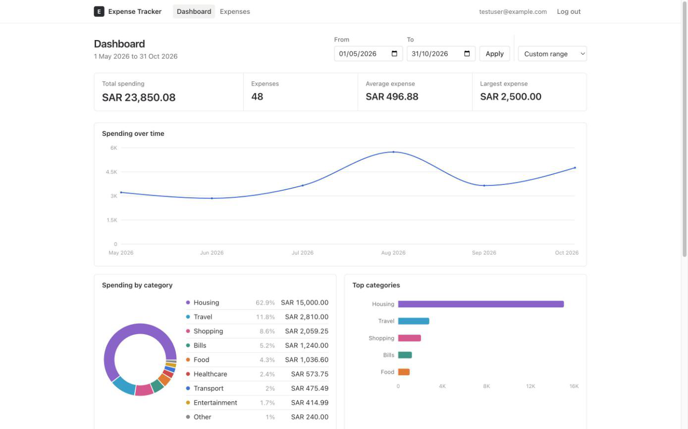
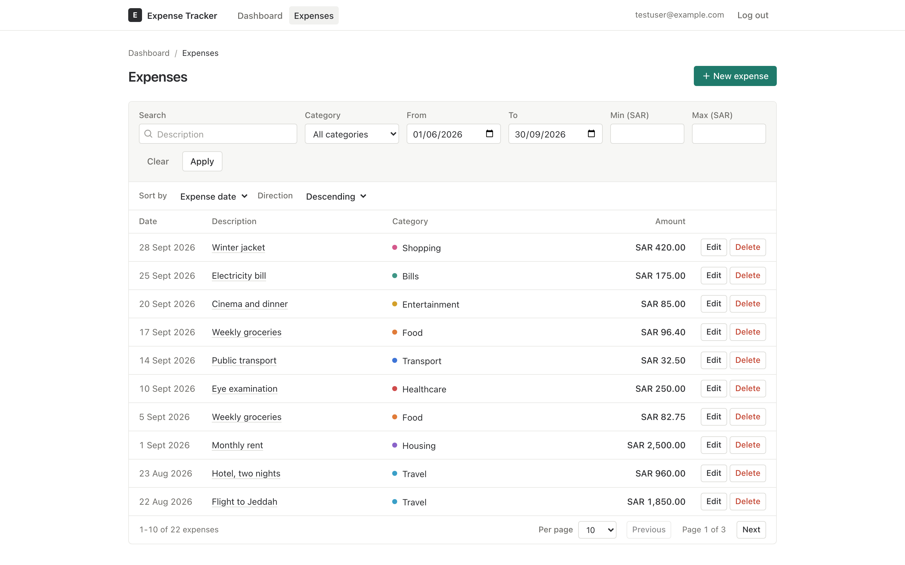
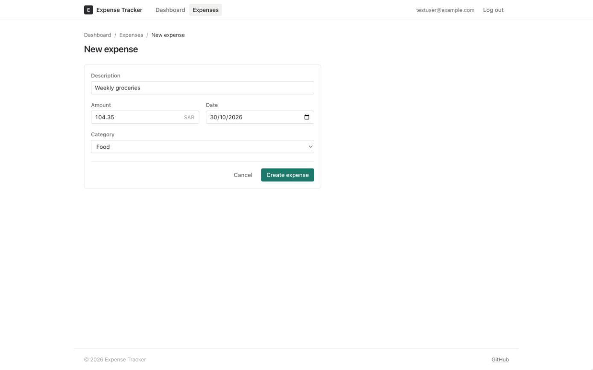
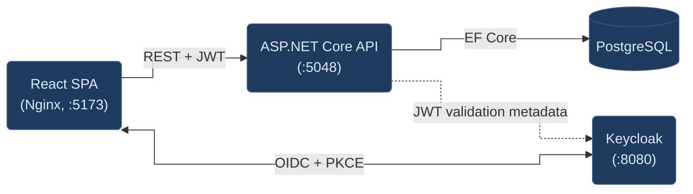

# Personal Expense Tracker

[](https://github.com/HamadSMA/expense-tracker/actions/workflows/ci.yml)

A full-stack app for recording personal expenses and seeing where the money goes. It has an ASP.NET Core Web API (.NET 10, EF Core, PostgreSQL), a React and TypeScript frontend, and sign-in through Keycloak. Each user can only see and change their own expenses.

## Screenshots


*Dashboard for a six-month custom range.*

| Expense list | Expense form |
| --- | --- |
|  |  |
| Filtering, sorting and pagination | Creating an expense |

## Features

- **Expenses:** create, view, edit and delete expenses with a category, amount (SAR), description and date.
- **Search and filters:** search by description; filter by category, date range and amount range; sort; paginate.
- **Dashboard:** totals and averages, spending over time, spending by category and the ten largest expenses. Ranges can be this week, this month, last month or a custom range.
- **Accounts:** sign-in and registration through Keycloak. Every page requires sign-in.

## Tech Stack

| Area | Technologies |
| --- | --- |
| Backend | C#, .NET 10, ASP.NET Core Web API, EF Core 10 (Npgsql), OpenAPI with Scalar |
| Frontend | React 19, TypeScript, Vite, React Router, TanStack Query, Recharts |
| Database | PostgreSQL 18 |
| Auth | Keycloak 26, OpenID Connect (authorization code + PKCE), JWT bearer |
| Testing | xUnit, WebApplicationFactory, Testcontainers, Vitest, React Testing Library |
| Tooling | Docker, Docker Compose, Nginx, GitHub Actions |

## Architecture



Keycloak handles authentication and issues access tokens. The API validates those tokens and enforces per-user data access.

The backend uses a layered architecture:

| Project | Responsibility |
| --- | --- |
| `Finance.Domain` | Entities: `User`, `Expense`, `Category` |
| `Finance.Application` | DTOs, validation rules, `IFinanceDbContext` |
| `Finance.Infrastructure` | EF Core context, entity configurations, indexes, migrations |
| `Finance.Api` | Controllers, authentication, CORS, OpenAPI |

Controllers access the database through `IFinanceDbContext`.

## Engineering Highlights

**Authentication and data isolation.** The API validates each token's signature, issuer, audience and lifetime against Keycloak. It maps the token's `sub` claim to a local user, creating that user on their first request. Every expense and dashboard query is filtered by that user's id. Requesting another user's expense returns `404`, so its existence isn't revealed. Integration tests check this with two users.

**Server-side querying.** The expense list combines optional filters, a case-insensitive search, a fixed set of sort fields and capped page sizes into a single EF Core query. It projects straight into response DTOs, without change tracking. A composite `(UserId, ExpenseDate)` index matches the main access pattern. The frontend keeps filter state in the URL, so filtered views can be bookmarked.

**Dashboard aggregation.** Totals and category breakdowns are calculated in SQL. The spending-over-time chart adjusts its grouping to the range: daily for up to a month, weekly for up to about four months, monthly beyond that.

**Validation and integration testing.** The API and the React form apply the same validation rules. Server-side validation errors are shown next to the matching form fields. Integration tests run the real API against PostgreSQL in Testcontainers, with the real migrations applied, and use a test authentication handler to simulate multiple users.

## Getting Started

Requires Docker with Docker Compose.

```bash
cp .env.example .env    # set POSTGRES_PASSWORD and KEYCLOAK_ADMIN_PASSWORD
docker compose up -d --build
```

| Service | URL |
| --- | --- |
| Web app | http://localhost:5173 |
| API | http://localhost:5048 |
| Keycloak admin console | http://localhost:8080 (credentials from `.env`) |

On first start, PostgreSQL creates the schema and seed categories from [`database-init.sql`](database-init.sql). Keycloak imports the `finance` realm from [`keycloak/finance-realm.json`](keycloak/finance-realm.json).

Open the web app and sign in with the demo user `testuser` / `password`, or register a new account. New accounts start empty. [`api-tests/seed-expenses.http`](api-tests/seed-expenses.http) adds sample data through the API.

Stop the stack with `docker compose down`. Add `-v` to also delete the data.

The frontend's API and Keycloak URLs are build arguments in `compose.yaml`, so changing them requires rebuilding the `web` image. To run the API outside Docker, see [`docs/local-setup.md`](docs/local-setup.md).

## Testing and CI

```bash
cd backend && dotnet test Finance.slnx        # integration tests need Docker
cd frontend/finance-web && npm ci && npm test
```

- **Backend:** unit tests for the validation rules. Integration tests cover CRUD, validation errors, cross-user access, unauthenticated requests, filtering, sorting, pagination and the dashboard calculations.
- **Frontend:** tests for the API client, the sign-in guard, form validation, the main pages (with mocked services) and the date-range logic.

GitHub Actions runs on pushes and pull requests to `main`. It builds and tests the backend and frontend, then builds Docker images for both; on pushes to `main` it also publishes them to GitHub Container Registry. Automated tests do not cover the full browser login flow or Keycloak token validation. The application is configured for local development and is not publicly deployed yet.

## License

[MIT](LICENSE)
